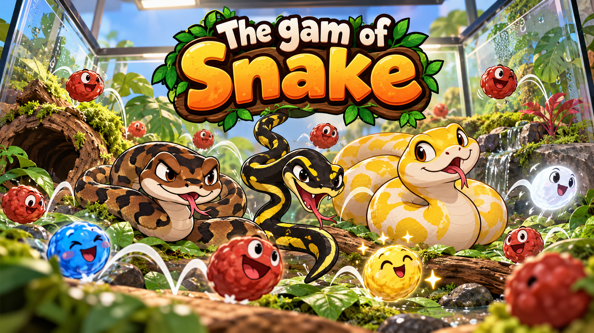
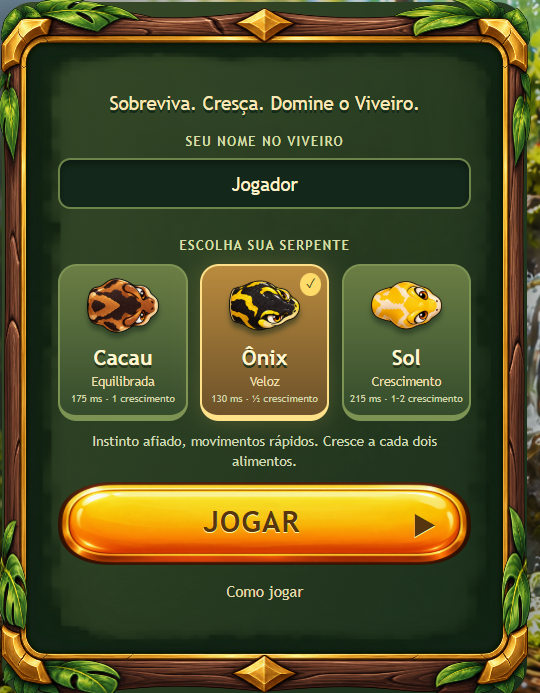
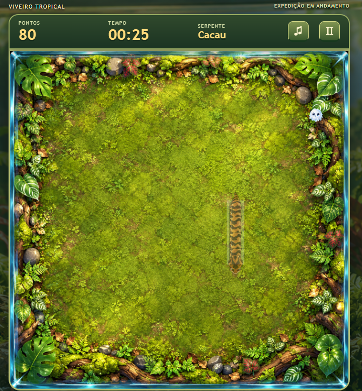

# The Game of Snake 🌿🐍



<p align="center"><strong>Sobreviva. Cresça. Domine o Viveiro.</strong></p>
<p align="center">Um clássico reinventado com serpentes expressivas, poderes imprevisíveis e um terrário tropical cheio de personalidade.</p>
<p align="center"><a href="#gameplay">Gameplay</a> · <a href="#como-executar">Como executar</a> · <a href="#tecnologias">Tecnologias</a> · <a href="#personalização">Personalização</a></p>

## Sobre o jogo

**The Game of Snake** é um jogo 2D para navegador inspirado no clássico da cobrinha. Escolha uma das três serpentes, colete alimentos e sobreviva dentro de um viveiro de vidro. Cada personagem tem seu próprio ritmo e crescimento, e os power-ups podem acelerar a partida, trocar a cabeça de lugar ou permitir atravessar paredes.

O projeto combina regras de grade com movimento visual suave, artes PNG com estilo cartoon tropical e uma interface que ocupa a janela do jogo. Funciona localmente sem configuração de serviços externos e oferece integração opcional com Firebase para ranking mundial.

## Imagens do jogo

<table>
  <tr>
    <th>Escolha sua serpente</th>
    <th>Explore o viveiro</th>
  </tr>
  <tr>
    <td width="43%"></td>
    <td width="57%"></td>
  </tr>
</table>

## Gameplay

A partida acontece em uma grade **20 × 20**. A cobra começa com três segmentos e se move continuamente. Você escolhe a direção, procura o próximo alimento e planeja o trajeto para não ficar sem saída.

- Cada alimento ou power-up coletado vale **10 pontos**.
- Cada coleta reduz o intervalo de movimento em **1 ms**, até o mínimo de **120 ms por célula**. A progressão reinicia a cada partida.
- Colidir com o vidro ou com o próprio corpo encerra a partida, exceto durante o efeito fantasma.
- A cobra não pode inverter diretamente o movimento em 180° pelos controles normais.
- A pontuação define a classificação; em caso de empate, o **menor tempo de partida** fica à frente.
- Pausas manuais e o preparo da inversão não entram no cronômetro competitivo.

### Três serpentes, três estratégias

| Serpente | Perfil | Intervalo inicial | Crescimento por carne normal |
| --- | --- | --- | --- |
| **Cacau** 🟤 | Equilibrada, ideal para começar | 175 ms/célula | 1 segmento |
| **Ônix** ⚫ | Veloz, para quem gosta de reflexos rápidos | 130 ms/célula | 1 segmento a cada 2 carnes |
| **Sol** 🟡 | Mais lenta e com crescimento acelerado | 215 ms/célula | Alterna entre 1 e 2 segmentos |

Quanto menor o intervalo, mais rápida a serpente. Cabeça, corpo e cauda têm artes próprias; o corpo acompanha as curvas em um caminho contínuo, sem espaços entre os segmentos.

### Alimentos e poderes

| Item | Chance de aparecer | Efeito |
| --- | --- | --- |
| 🔴 **Carne normal** | **65%** | Aumenta o corpo conforme a serpente escolhida |
| 🔵 **Velocidade** | **25%** | Reduz o intervalo atual em 25% por 5 segundos, respeitando o mínimo de 120 ms/célula |
| 🟡 **Confusão / inversão** | **5%** | A cauda vira a nova cabeça; um pequeno balão sinaliza a confusão durante 0,5 segundo de preparo |
| ⚪ **Fantasma** | **5%** | Por 5 segundos, permite atravessar o próprio corpo e reaparecer na borda oposta do tabuleiro |

Todos valem pontos e contribuem para a aceleração por coleta. Apenas a carne normal aumenta o corpo. Recolher novamente o poder de velocidade ou fantasma renova sua duração. Se o fantasma terminar com a cabeça sobreposta ao corpo, há uma janela limitada de até 1 segundo para sair da sobreposição.

### Controles

| Ação | Computador | Celular e tablet |
| --- | --- | --- |
| Mover | **WASD** ou **setas** | Joystick virtual ou deslize no tabuleiro |
| Pausar / continuar | **Esc**, **P** ou botão de pausa | Botão de pausa |
| Tela cheia | Botão no canto superior direito | Botão, quando suportado pelo navegador |
| Música e efeitos | Opções e botão de áudio | Opções e botão de áudio |

No iPhone, a disponibilidade de tela cheia depende do Safari. A interface informa quando o navegador não oferece suporte. Ao ocultar a página, a partida pausa automaticamente.

## Recursos

- Menu com seleção de personagens, apelido salvo e memória da última serpente escolhida.
- Tutorial com treino jogável sem registrar pontuação.
- HUD com pontos, tempo, personagem e indicadores de poderes.
- Pausa, reinício e tela de Game Over com estatísticas da expedição.
- Ranking geral e filtros por serpente, com uma melhor marca por identidade em cada categoria.
- Música ambiente e efeitos originais sintetizados com **Web Audio API**, com preferências salvas.
- Layout responsivo, controles por Pointer Events e respeito à preferência de movimento reduzido.
- Artes PNG locais e substituíveis, sem dependência de imagens ou fontes hospedadas por terceiros durante o jogo.

## Tecnologias

| Tecnologia | Papel no projeto |
| --- | --- |
| **HTML5 e CSS3** | Menus, HUD, painéis, responsividade e molduras da interface |
| **JavaScript com ES Modules** | Motor, regras, controles e organização modular |
| **Phaser 3** | Cena 2D, renderização, texturas, efeitos e interação com o tabuleiro |
| **Canvas e Web Audio API** | Corpo contínuo das cobras e áudio sintetizado |
| **Vite** | Servidor de desenvolvimento e build de produção |
| **Firebase Authentication** | Identidade anônima, sem conta e senha para o jogador |
| **Cloud Firestore** | Ranking mundial opcional |
| **Firebase Hosting** | Configuração de hospedagem preparada no projeto |
| **localStorage** | Preferências, apelido e ranking local |
| **Node.js Test Runner e Playwright** | Testes das regras e dos fluxos de interface |
| **Sharp** | Preparação e recorte das artes durante o desenvolvimento |

## Como executar

Tenha **Node.js 22.12+ ou 24+** com npm e Git instalados.

```sh
# Clone o projeto
git clone https://github.com/DenilsomLobo/the_game-of_snake.git
cd the_game-of_snake

# Instale as dependências e inicie o servidor
npm install
npm run dev
```

Abra o endereço indicado pelo Vite no terminal, normalmente `http://localhost:5173`. Informe um apelido de **2 a 20 caracteres**, escolha sua companheira e clique em **Jogar**.

No Windows, você também pode abrir [Testar Jogo.cmd](Testar%20Jogo.cmd) com dois cliques. O arquivo instala as dependências quando necessário, inicia o servidor e abre o navegador. Use **Ctrl+C** na janela para encerrar.

Se o PowerShell bloquear `npm.ps1`, use `npm.cmd install` e `npm.cmd run dev`. Para testar no celular, use o endereço de rede informado pelo Vite, na mesma rede do computador e com acesso permitido no firewall.

### Comandos disponíveis

| Comando | Descrição |
| --- | --- |
| `npm run dev` | Inicia o jogo em desenvolvimento |
| `npm test` | Executa os testes das regras e da geometria das cobras |
| `npm run test:e2e` | Verifica os fluxos de interface em navegador |
| `npm run build` | Gera os arquivos de produção em `dist/` |
| `npm run preview` | Serve o build localmente para conferência |
| `npm run art:prepare` | Recorta novamente as pranchas originais das cobras |

Os testes de interface usam Google Chrome instalado. O caminho padrão é o da instalação Windows em `C:/Program Files/Google/Chrome/Application/chrome.exe`; defina a variável `CHROME_PATH` se o executável estiver em outro local. As capturas geradas ficam em `artifacts/` e não são versionadas.

## Personalização

As regras configuráveis ficam em [`src/game/config.js`](src/game/config.js):

```js
// Probabilidades: com soma 100, os pesos equivalem a porcentagens.
export const FOOD_WEIGHTS = {
  normal: 65,
  speed: 25,
  reverse: 5,
  ghost: 5
};

export const POWER_MS = 5000;
export const REVERSE_PAUSE_MS = 500;
export const SPEED_PROGRESSION = {
  msPerFood: 1,
  minInterval: 120
};
```

Altere também o campo `interval` de cada personagem em `SNAKES` para mudar sua velocidade inicial. Os pesos são proporcionais: se a soma não for 100, o motor normaliza as chances.

As artes finais estão em `public/assets/`, separadas por cenário, personagem, alimento, interface e efeito. Os originais ficam em `art-source/`. Leia o [guia de artes](docs/assets.md) antes de trocar sprites ou recortar pranchas. O [balão de confusão](docs/confusion-art.md) possui sua própria documentação.

## Ranking local e Firebase

O jogo funciona sem Firebase: resultados e preferências ficam no navegador, e a interface identifica o **modo local**. Limpar os dados do navegador remove esse histórico e altera a identidade local.

Para habilitar o ranking mundial:

1. Crie um projeto Firebase e registre um aplicativo web.
2. Habilite **Authentication → Anonymous** e **Cloud Firestore**.
3. Autorize o domínio do jogo nas configurações de autenticação.
4. Copie `.env.example` para `.env` e preencha os quatro valores públicos do aplicativo:

   ```dotenv
   VITE_FIREBASE_API_KEY=
   VITE_FIREBASE_AUTH_DOMAIN=
   VITE_FIREBASE_PROJECT_ID=
   VITE_FIREBASE_APP_ID=
   ```

5. Instale o Firebase CLI, autentique-se e associe o projeto:

   ```sh
   npm install -g firebase-tools
   firebase login
   firebase use --add
   ```

6. Gere o build e publique a hospedagem, as regras e os índices:

   ```sh
   npm run build
   firebase deploy --only hosting,firestore
   ```

Aguarde o índice composto ficar pronto. Ele ordena por categoria, pontuação decrescente e tempo crescente. Transações mantêm a melhor marca do jogador em cada categoria. Resultados locais não são enviados retroativamente; falhas de sincronização não possuem fila automática de reenvio.

### Segurança do ranking

As regras em `firestore.rules` validam identidade, campos, tipos e limites, impedindo a alteração dos registros de outro usuário. As leituras são públicas, incluindo o identificador anônimo e as estatísticas; evite dados pessoais nos apelidos.

**As pontuações ainda são calculadas no cliente e podem ser falsificadas.** Uma competição com verificação confiável exige validação no servidor: por exemplo, Cloud Functions que iniciem partidas com semente e token de uso único, recebam os comandos e reexecutem o motor antes de registrar o resultado. Esse backend não está implementado. Os testes locais também não substituem testes das regras no Firebase Emulator.

O arquivo `.env` é ignorado pelo Git. Não coloque chaves administrativas, contas de serviço ou outros segredos no frontend.

## Estrutura do projeto

```text
the_game-of_snake/
├── Assets/                 # Capa e capturas usadas neste README
├── art-source/             # Artes originais e pranchas dos personagens
├── docs/                   # Guias das artes
├── e2e/                    # Testes e cenários de interface
├── public/assets/          # PNGs consumidos pelo jogo
├── scripts/                # Preparação das artes
├── src/
│   ├── firebase/           # Ranking, autenticação e persistência
│   ├── game/               # Motor, configuração, cena, áudio e renderização
│   ├── styles/             # Estilos e responsividade
│   ├── ui/                 # Layout, encaixe do menu e tela cheia
│   └── utils/              # Armazenamento, nomes e formatação
├── tests/                  # Testes de lógica e geometria
├── .env.example
├── firebase.json
├── firestore.indexes.json
├── firestore.rules
├── package.json
└── Testar Jogo.cmd
```

O motor é independente da renderização. Isso permite testar movimento, colisões, crescimento, poderes e pontuação sem abrir uma cena do Phaser. O movimento usa tempo acumulado para manter o ritmo entre diferentes taxas de atualização.

## Estado do projeto

Versão jogável para portfólio, com testes automatizados e build de produção. O ranking mundial e a publicação dependem de configurar seu próprio projeto Firebase. A interface foi verificada em navegador com tamanhos de desktop e celular; a validação em aparelhos físicos Android e iOS continua recomendada antes de uma publicação ampla.

A identidade visual foi desenvolvida com apoio de geração de imagens por IA, com artes organizadas para edição e substituição. O áudio é sintetizado no navegador.

---

Desenvolvido por [DenilsomLobo](https://github.com/DenilsomLobo).
Para mais portifólios: [Clique aqui !](https://portifolio-denilsom-lobo.web.app/).
Para testar o jogo online: [Clique aqui !](https://portifolio-denilsom-lobo.web.app/games/the_game_of_snake/play/).
